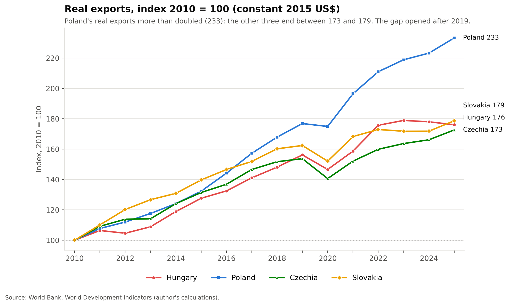

# Export Competitiveness and Economic Performance in Central Europe

**A comparative analysis of Hungary, Poland, Czechia and Slovakia, 2010-2025**
Independent research project by Ghulam Mustafa (2026). Not employer work or coursework.

## Objective and research question

How has export competitiveness evolved across Hungary, Poland, Czechia and Slovakia since 2010, and what economic factors help explain differences in their trade performance?

Sub-questions: strongest export growth; trade dependence; trade balances; FDI relative to GDP; the role of manufacturing; the effect of COVID-19 and the post-2022 environment; which country strengthened its competitiveness most.

## Key findings

| | Hungary | Poland | Czechia | Slovakia |
|---|---|---|---|---|
| Real exports, 2025 (2010 = 100) | 176.1 | **233.2** | 172.6 | 178.7 |
| Real export CAGR 2010-2025 | 3.8% | **5.8%** | 3.7% | 3.9% |
| Mean trade openness, % of GDP | 161.8 | 98.4 | 140.4 | **178.5** |
| Mean trade balance, % of GDP | 4.1 | 2.0 | **5.3** | 0.9 |
| Real export growth in 2020 | -6.1% | **-1.1%** | -8.5% | -6.4% |

- **Poland** is the strongest real export performer and moved from a trade deficit (-2.4% of GDP in 2010) to steady surpluses. The gap with the other three widened mainly after 2019.
- Openness is not the same as growth: the two most open economies (Slovakia, Hungary) grew real exports more slowly than Poland, the least open.
- Hypotheses were frozen before the analysis (see `docs/Phase1_Design_Lock.md`):

| Hypothesis | Result | Key number |
|---|---|---|
| H1 Smaller economies are more open than Poland | Supported | HUN and SVK above POL in 16/16 years |
| H2 Manufacturing-intensive economies export more | Not supported | pooled r = +0.22 (rule: at least 0.30); rankings differ |
| H3 FDI inflows go with stronger export growth | Not supported | pooled r = -0.13; Hungary's FDI swings from -40% to +106% of GDP |
| H4 COVID-19 disruption, then recovery | Supported | all four fell in 2020 and beat their 2010-19 average in 2021 |

Association only: 64 non-independent country-year observations; no causal claims.



## Data

- **Source:** World Bank, World Development Indicators, downloaded as CSV from [DataBank](https://databank.worldbank.org) (file stamp "Last Updated: 10/08/2026"; accessed 25 October 2026). Full list in `sources/data_sources.md`.
- **Coverage:** 4 countries x 2010-2025 (2009 downloaded only as the base year for 2010 growth). 14 indicators, 0 missing values in this release.
- **Rules:** raw data never edited; missing values stay missing; outliers flagged (pooled 1.5 x IQR or within-country |z| > 2.5), never dropped; medians reported next to means.

## Literature

The report (Section 3) places the results in research on country size and openness (Alesina and Wacziarg 1998), Central Europe's FDI-led, German-centred manufacturing model (Nölke and Vliegenthart 2009; IMF 2013; Stehrer and Stöllinger 2015), FDI spillovers and measurement problems (Javorcik 2004; Damgaard, Elkjaer and Johannesen 2019) and the COVID-19 and 2022 shocks (IMF 2022; EBRD 2022). Full list: `sources/literature.md`.

## Method

Real export growth from constant 2015 US$ exports; trade balance and openness as % of GDP; export index (2010 = 100); CAGR; period averages (2010-19, 2020-21, 2022-25); descriptive statistics; pooled and within-country Pearson correlations. Everything is built with live Excel formulas and independently recomputed in Python (0 mismatches).

## Repository

```
data/raw/        WDI download, untouched (data + series metadata)
data/cleaned/    clean long-format dataset (64 rows) and data-quality table
analysis/        trade_analysis.xlsx (workbook, 6 sheets), analysis.py, workbook and chart scripts, cross-check
charts/          the 8 charts (PNG)
report/          Central_Europe_Trade_Report.pdf and the script that builds it
sources/         data_sources.md, literature.md (15 verified sources with links)
docs/            design lock (frozen hypotheses) and phase logs
```

## How to reproduce

Requires Python 3.10+ (`pip install -r requirements.txt`).

```bash
RAW=data/raw/3ed9e304-4fec-4c09-ab92-21d2d709e1a1_Data.csv
python analysis/analysis.py $RAW results.json                         # all headline numbers and the 4 hypothesis tests
python analysis/make_charts.py $RAW charts                            # the 8 PNG charts
python analysis/build_workbook.py $RAW phase3.xlsx                    # workbook sheets 01-04, 06 (live formulas)
python analysis/add_charts.py phase3.xlsx analysis/trade_analysis.xlsx   # adds the live Excel charts (05_CHARTS)
# open and save the workbook in Excel so formula values are cached, then:
python analysis/analysis_crosscheck.py $RAW analysis/trade_analysis.xlsx  # expects FAILURES: 0
python report/build_report.py charts results.json report/Central_Europe_Trade_Report.pdf
```

## Tools

Excel (workbook, live formulas and charts), Python (pandas, matplotlib, openpyxl, reportlab) for cross-checks, charts and the report.

## Limitations

Descriptive, not causal; small non-independent sample; FDI distorted by pass-through capital (especially Hungary); exports/GDP measures trade intensity, not competitiveness; 2025 values may be revised. See section 6 of the report.
